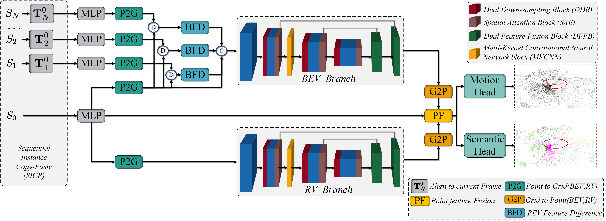
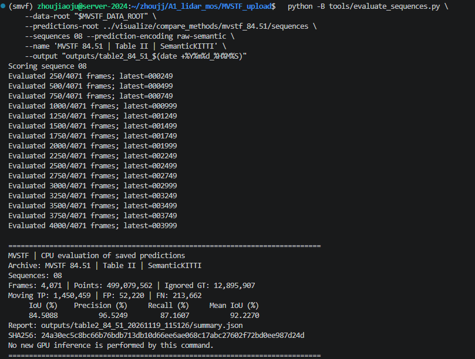
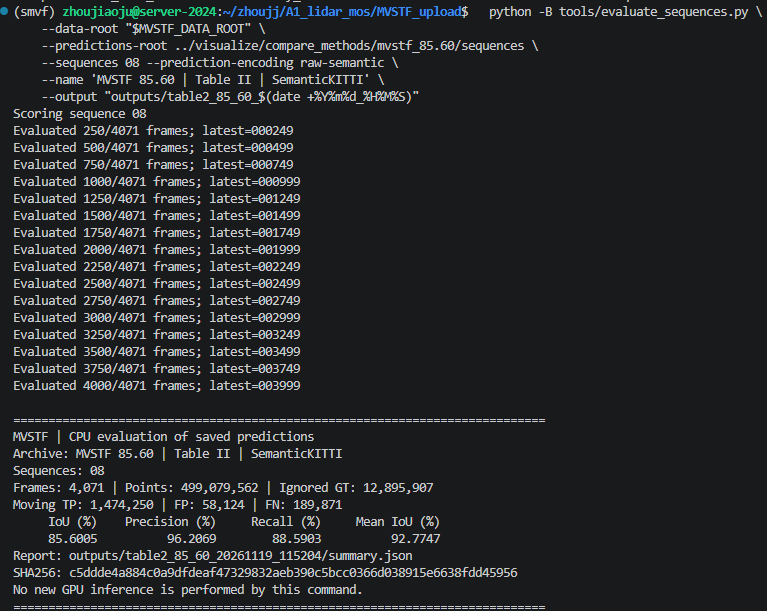
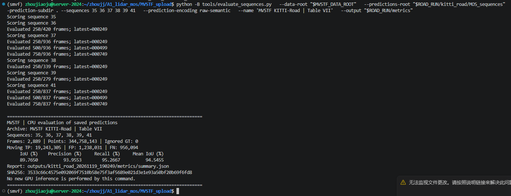
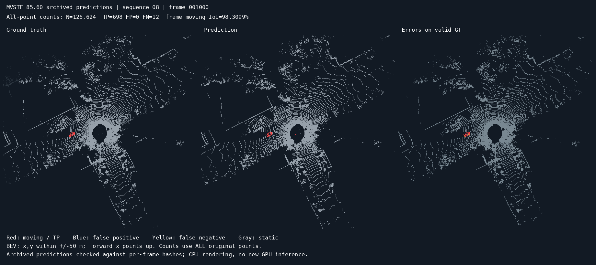
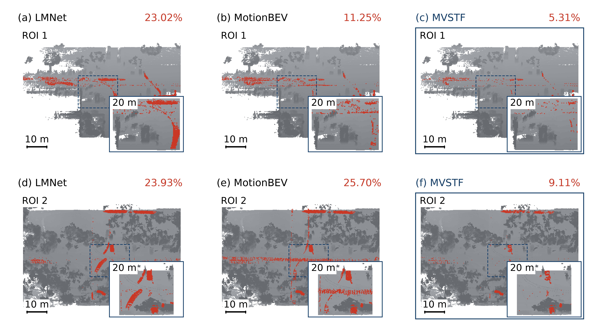

# MVSTF: Multi-View Spatio-Temporal Fusion for LiDAR-Based Moving Object Segmentation

[中文](README.zh-CN.md) · [Paper](https://arxiv.org/html/2611.20872v1) · [Code](https://github.com/ZhouJJ111/MVSTF)

Authors: Jiaoju Zhou, Chao Ye, Xuebo Yang, and Weiyang Lin

MVSTF fuses multi-view spatio-temporal features from consecutive LiDAR scans for moving object segmentation (MOS), with an auxiliary branch for semantic prediction.



## 1. Environment setup

Environment: Linux x86_64, Python 3.7.12, PyTorch 1.10.1+cu111, torchvision 0.11.2+cu111, and CUDA 11.1. The Conda environment is named `MVSTF`. Dependency versions are specified in `requirements.txt` and `environment.yaml`.

First, install the CUDA 11.1 development toolkit and a compatible compiler. Make sure `nvcc --version` works, and set `CUDA_HOME` to the CUDA installation directory if necessary. Then run:

```bash
git clone https://github.com/ZhouJJ111/MVSTF.git
cd MVSTF

conda env create -f environment.yaml
conda activate MVSTF
python -m pip install --only-binary=:all: -r requirements.txt
python -m pip install --no-build-isolation ./deep_point
python -m pip check
```

If the `MVSTF` environment already exists, activate it directly, adjusting the Conda installation path as needed:

```bash
source "$HOME/anaconda3/etc/profile.d/conda.sh"
conda activate MVSTF
```

Check the installation:

```bash
python -c "import torch, deep_point; import point_deep.cpu_kernel, point_deep.cuda_kernel; print('PyTorch:', torch.__version__); print('CUDA runtime:', torch.version.cuda); print('CUDA available:', torch.cuda.is_available())"
```

The CUDA runtime bundled with PyTorch does not include `nvcc`, so compiling `deep_point` still requires the development toolkit. These dependency versions match the existing working environment; installation and CUDA compilation on a new machine must be checked on the target device. Run all commands below from the repository root with the `MVSTF` environment activated.

## 2. Data preparation

### SemanticKITTI

Download the scans, labels, poses, and calibration files from [SemanticKITTI](http://www.semantic-kitti.org/dataset.html#overview) and arrange them as follows:

```text
SemanticKITTI/dataset/sequences/
├── 00/
│   ├── calib.txt
│   ├── poses.txt
│   ├── velodyne/
│   │   ├── 000000.bin
│   │   └── ...
│   └── labels/
│       ├── 000000.label
│       └── ...
├── ...
├── 08/                     # validation, 4,071 frames
└── 21/
```

### KITTI-Road

Preprocess KITTI-Road following [MotionSeg3D](https://github.com/haomo-ai/MotionSeg3D), then arrange it in the sequence structure below. Each sequence contains `calib.txt`, `poses.txt`, `velodyne/`, and `labels/`; validation sequence `35` is expanded as an example:

```text
KITTI-Road/sequences/
├── 30/                     # training sequence
├── 31/
├── 32/
├── 33/
├── 34/
├── 35/                     # validation sequence
│   ├── calib.txt
│   ├── poses.txt
│   ├── velodyne/
│   │   ├── 000000.bin
│   │   ├── 000001.bin
│   │   └── ...
│   └── labels/
│       ├── 000000.label
│       ├── 000001.label
│       └── ...
├── 36/                     # validation sequence
├── 37/                     # validation sequence
├── 38/                     # validation sequence
├── 39/                     # validation sequence
├── 40/                     # training sequence
└── 41/                     # validation sequence
```

File format requirements:

- **Scans:** each `.bin` file stores `float32` values, with `[x, y, z, intensity]` for each point (16 bytes per point).
- **Labels:** each `.label` file stores one `uint32` label per point, matching the number and order of points in the corresponding scan. The lower 16 bits contain the raw semantic ID: `9` for static, `251` for moving, and `0` for ignored points. The upper 16 bits may contain instance IDs. Keep raw class IDs in the files; the loader maps them to training classes using the YAML configuration.
- **Calibration:** `calib.txt` uses `name: values` rows, with 12 values per matrix. It must include the camera/LiDAR coordinate transform `Tr`.
- **Poses:** each line of `poses.txt` contains a flattened 3×4 pose matrix (12 values). There must be one line per frame, ordered to match the scan frame IDs, for multi-frame alignment.

Use two-digit sequence directory names and consecutive six-digit frame IDs starting at `000000`. Scan and label files must have matching names.

### Data paths and splits

`MVSTF_DATA_ROOT` points directly to the `sequences/` directory containing the sequence folders. For example:

```bash
export MVSTF_DATA_ROOT=/path/to/SemanticKITTI/dataset/sequences
```

For KITTI-Road evaluation alone, a separate Road data directory can also be used:

```bash
export MVSTF_DATA_ROOT=/path/to/KITTI-Road/sequences
```

The default joint training configuration requires both datasets. Place Road sequences `30`–`41` alongside SemanticKITTI sequences `00`–`21` under a shared `sequences/` directory, and point the variable to that directory.

| Dataset | Training sequences | Validation sequences | Test sequences |
| --- | --- | --- | --- |
| SemanticKITTI | 00–07, 09–10 | 08 (4,071 frames) | 11–21 (no public labels) |
| KITTI-Road | 30–34, 40 | 35–39, 41 (2,889 frames) | — |

Default training uses both sets of training sequences listed above. Class mappings and splits are defined in `datasets/semantic-kitti-mos.yaml` and `datasets/semantic-kitti-single.yaml`. The default validation sequence is `08`; the Road command selects its six validation sequences using `--sequences`, without editing the YAML files.

### Training object bank

For training with copy-paste augmentation, download the [SMVF object bank](https://drive.google.com/file/d/1QdSpkMLixvKQL6QPircbDI_0-GlGwsdj/view?usp=sharing) and extract its class folders into `object_bank_semkitti/` at the repository root. The object bank is not required for inference or scoring.

## 3. Training

Prepare both training datasets and the object bank, then review the selected configuration and initialization checkpoint before running. This example uses four GPUs; adjust the GPU IDs and process count to match the available devices:

```bash
export CUDA_VISIBLE_DEVICES=0,1,2,3

python -m torch.distributed.launch --nproc_per_node=4 --master_port=20008 train.py \
  --config config/config_smvf_sgd_ohem_vfe_k8_fp16_48epoch.py
```

Checkpoints are saved to `experiments/<config-name>/checkpoint/`. If `14-model.pth` exists in that directory, training loads parameters with matching names and shapes; the optimizer and learning-rate scheduler are initialized according to the configuration. Otherwise, training starts from the model's default initialization. This retains the public training implementation; the full training protocols for the historical checkpoints still need to be verified individually.

## 4. Pretrained checkpoints

Download the appropriate checkpoints from the table below and place them in `checkpoint_best/` at the repository root:

| Checkpoint file | Dataset | Moving IoU | Download |
| --- | --- | --- | --- |
| `semantickitti-85.60.pth` | SemanticKITTI 08 | 85.60% | [Google Drive](https://drive.google.com/file/d/1_wA9ASMtmvhuM1hDznrqTvnR8hOg0kQ8/view?usp=drive_link) |
| `semantickitti-84.51.pth` | SemanticKITTI 08 | 84.51% | [Google Drive](https://drive.google.com/file/d/17pI5SGKVOjii4Ed1nXeEC5bwSzViPyse/view?usp=drive_link) |
| `kitti-road-89.76497.pth` | KITTI-Road | 89.76497% (approximately 89.8%) | [Google Drive](https://drive.google.com/file/d/15Vm_JDQpG1OTzp66cr1lNeZ-Xw0IcFJy/view?usp=drive_link) |

```text
checkpoint_best/
├── semantickitti-85.60.pth
├── semantickitti-84.51.pth
└── kitti-road-89.76497.pth
```

The two SemanticKITTI checkpoints use different versions of the network architecture. Use the corresponding configurations below. Checkpoint filenames retain their historical result identifiers; scoring results for saved predictions and terminal screenshots are provided in Section 7.

## 5. SemanticKITTI inference and evaluation

### Inference

Select an available GPU, set the data path, and run the 85.60 checkpoint:

```bash
export CUDA_VISIBLE_DEVICES=0
export MVSTF_DATA_ROOT=/path/to/SemanticKITTI/dataset/sequences

python -m torch.distributed.launch --nproc_per_node=1 --master_port=10008 infer.py \
  --config config/config_smvf_sgd_ohem_vfe_k8_fp16_48epoch.py \
  --checkpoint checkpoint_best/semantickitti-85.60.pth \
  --start_epoch 17 --end_epoch 17 \
  --output-dir outputs/semantickitti_85_60
```

Predictions are saved to `outputs/semantickitti_85_60/val08/MOS_sequences/08/`.

The 84.51 checkpoint uses the earlier MAFL architecture and requires its dedicated configuration:

```bash
python -m torch.distributed.launch --nproc_per_node=1 --master_port=10008 infer.py \
  --config config/config_mvstf_84_51.py \
  --checkpoint checkpoint_best/semantickitti-84.51.pth \
  --start_epoch 27 --end_epoch 27 \
  --output-dir outputs/semantickitti_84_51
```

Predictions are saved to `outputs/semantickitti_84_51/val08/MOS_sequences/08/`. Use a new, empty output directory for each inference run. When repeating a run, change `--output-dir` and update the paths in the evaluation command accordingly.

Inference uses FP16, four XY sign-flip augmentations, and a temporal window with the current frame and eight history slots. At the start of a sequence, subsequent frames fill the window; this is the existing loader's boundary handling.

### Evaluation

After inference completes successfully, score the exported prediction labels:

```bash
python tools/evaluate_sequences.py \
  --data-root "$MVSTF_DATA_ROOT" \
  --predictions-root outputs/semantickitti_85_60/val08/MOS_sequences \
  --prediction-subdir . --sequences 08 \
  --prediction-encoding raw-semantic \
  --name 'MVSTF 85.60 | Table II | SemanticKITTI' \
  --output outputs/semantickitti_85_60/metrics
```

To evaluate the 84.51 checkpoint, replace `85_60` with `84_51` in the paths and update `--name`. The scorer checks frame IDs, per-frame point counts, and class encoding, then reports moving IoU, precision, recall, and mean IoU. Ignored ground-truth classes are excluded from scoring. See the [evaluation documentation](docs/evaluation.md) for more options.

`infer_semantic.py` exports semantic predictions, and `infer_test.py` exports predictions for the hidden test set.

## 6. KITTI-Road inference and evaluation

Use the separate Road checkpoint for inference on sequences `35, 36, 37, 38, 39, 41`. Replace the data path with the actual directory containing these sequences. This example uses a separate Road directory:

```bash
export CUDA_VISIBLE_DEVICES=0
export MVSTF_DATA_ROOT=/path/to/KITTI-Road/sequences
export ROAD_RUN="outputs/kitti_road_$(date +%Y%m%d_%H%M%S)"

python -B -m torch.distributed.launch --nproc_per_node=1 --master_port=10009 infer.py \
  --config config/config_smvf_sgd_ohem_vfe_k8_fp16_48epoch.py \
  --checkpoint checkpoint_best/kitti-road-89.76497.pth \
  --start_epoch 4 --end_epoch 4 \
  --sequences 35 36 37 38 39 41 \
  --prediction-split kitti_road \
  --output-dir "$ROAD_RUN" && \
python -B tools/evaluate_sequences.py \
  --data-root "$MVSTF_DATA_ROOT" \
  --predictions-root "$ROAD_RUN/kitti_road/MOS_sequences" \
  --prediction-subdir . --sequences 35 36 37 38 39 41 \
  --prediction-encoding raw-semantic \
  --name 'MVSTF KITTI-Road | Table VII' \
  --output "$ROAD_RUN/metrics"
```

The command creates a timestamped output directory for this run and starts scoring only after inference succeeds. Predictions are saved to `$ROAD_RUN/kitti_road/MOS_sequences/`, and full evaluation reports are saved to `$ROAD_RUN/metrics/`.

Final metrics are calculated from the accumulated confusion matrices across all six validation sequences, covering 2,889 frames. Moving IoU is approximately 89.8% when expressed as a percentage. Use the actual terminal output for each new run.

## 7. Results and visualization

The following results come from CPU scoring of saved predictions. Table II in the paper corresponds to SemanticKITTI, and Table VII corresponds to KITTI-Road.

| Dataset | Checkpoint | Frames | Moving IoU |
| --- | --- | --- | --- |
| SemanticKITTI 08 | `semantickitti-84.51.pth` | 4,071 | 84.5088% |
| SemanticKITTI 08 | `semantickitti-85.60.pth` | 4,071 | 85.6005% |
| KITTI-Road, six validation sequences | `kitti-road-89.76497.pth` | 2,889 | 89.7650% |

### Table II: SemanticKITTI 84.51



### Table II: SemanticKITTI 85.60



### Table VII: KITTI-Road 89.8



All three screenshots were provided by the authors from terminal runs and show scoring progress and summaries for saved predictions. The scoring commands shown in the screenshots run on the CPU; model inference is performed using the inference commands above.

### Point cloud visualization



[Sequence video](demo/seq08.mp4) · [Visualization documentation](docs/visualization.md) · [Evaluation documentation](docs/evaluation.md)

The image shows ground-truth labels, model predictions, and error distributions. The video shows 60 consecutive frames from sequence 08 at a playback rate of 10 fps.

### SuMa++ + MVSTF: odometry and mapping applications

See [Tables VIII–IX and metric definitions](results/slam/README.md) for trajectory errors, dynamic filtering, and static-structure preservation when combining MVSTF motion masks with SuMa++. Both tables cover KITTI odometry training sequences `00`–`10`. Table VIII reports means and sample standard deviations over five backend runs with fixed motion masks.



Fig. 11 shows two local regions of sequence `08`, with columns corresponding to LMNet, MotionBEV, and MVSTF. Red marks dynamic-only reference voxels that remain occupied; gray shows other occupied voxels, and blue dashed boxes locate the enlarged regions. MVSTF achieves dynamic-voxel residuals of **5.31%** and **9.11%** in the two regions.

All methods use the same SuMa++ baseline-estimated poses, voxel grid, and visualization settings. The figure shows voxel occupancy before surfel fusion. The **4.02%** in Table IX is the dynamic-voxel residual pooled across all sequences `00`–`10`, a different scope from the local regions in the figure.

[Table VIII: trajectory error CSV](results/slam/odometry.csv) · [Table IX: mapping metrics and counts CSV](results/slam/mapping.csv)

## 8. Citation

```bibtex
@article{zhou2026mvstf,
  title={MVSTF: Multi-View Spatio-Temporal Fusion for LiDAR-Based Moving Object Segmentation},
  author={Zhou, Jiaoju and Ye, Chao and Yang, Xuebo and Lin, Weiyang},
  journal={arXiv preprint arXiv:2611.20872},
  year={2026}
}
```

## 9. Acknowledgments

This project draws on [semantic-kitti-api](https://github.com/PRBonn/semantic-kitti-api), [LiDAR-MOS](https://github.com/PRBonn/LiDAR-MOS), [MotionSeg3D](https://github.com/haomo-ai/MotionSeg3D), [MotionBEV](https://github.com/xieKKKi/MotionBEV), [MarS3D](https://github.com/CVMI-Lab/MarS3D), [SMVF](https://github.com/GangZhang842/SMVF), and [SuMa++](https://github.com/PRBonn/semantic_suma). The original notices and license terms of the third-party code are preserved.
