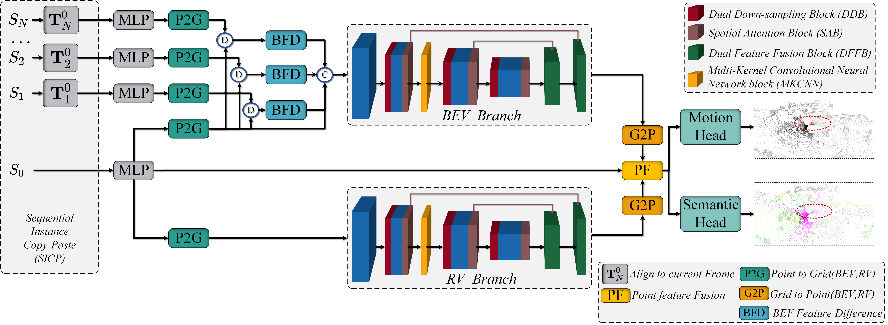
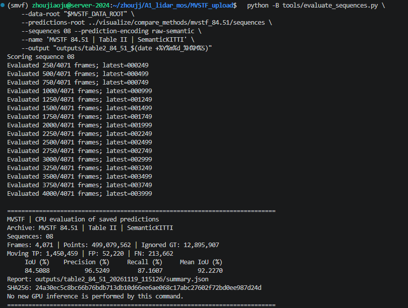
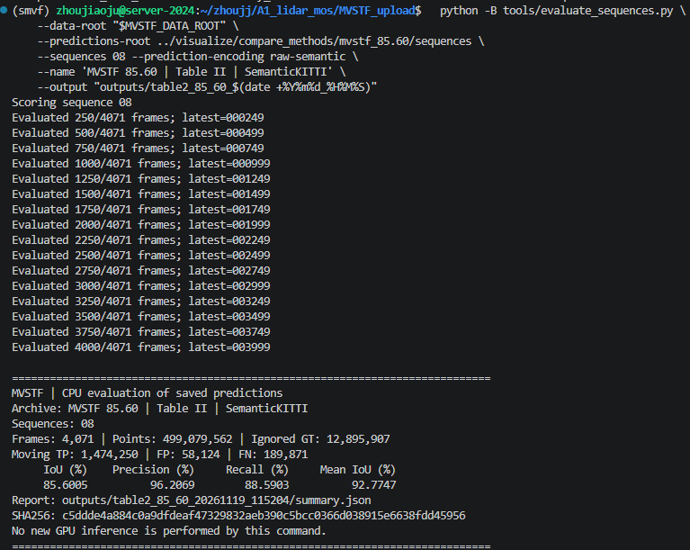
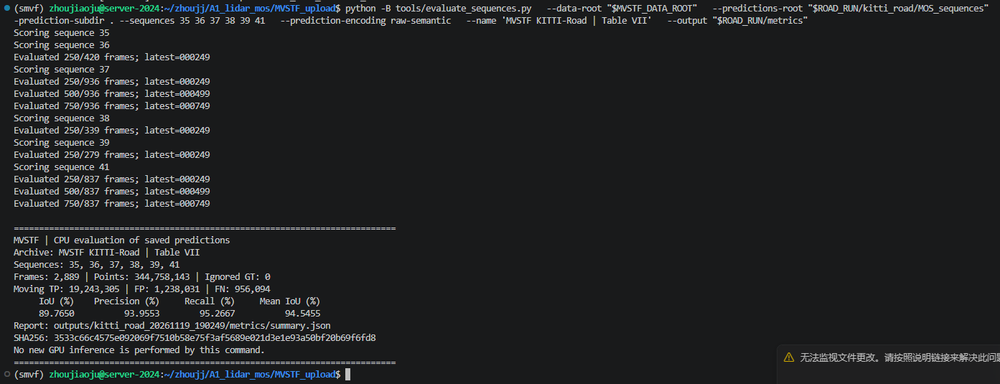
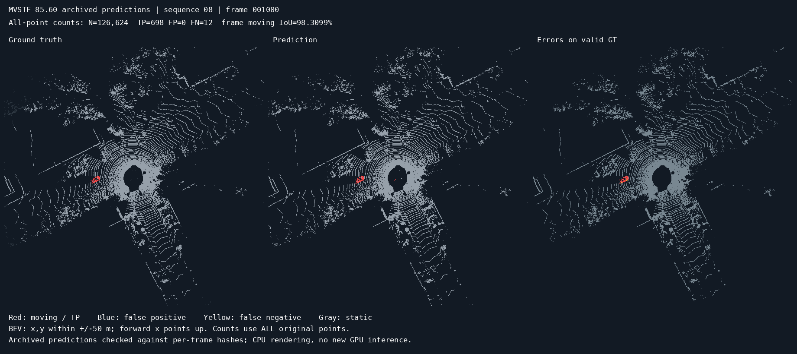
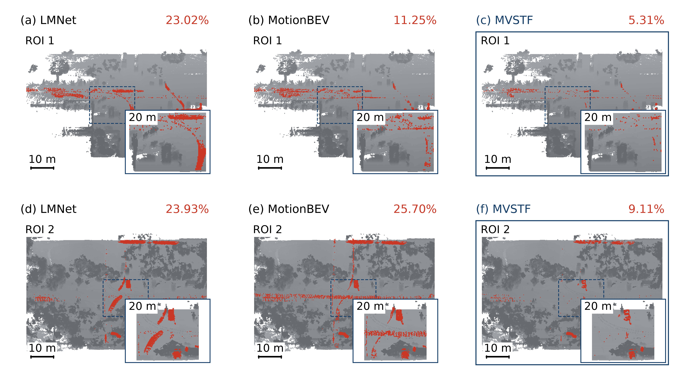

# MVSTF：用于激光雷达运动目标分割的多视图时空融合

[English](README.md) · [论文](https://arxiv.org/html/2611.20872v1) · [代码](https://github.com/ZhouJJ111/MVSTF)

作者：Jiaoju Zhou、Chao Ye、Xuebo Yang、Weiyang Lin

MVSTF 融合连续激光雷达扫描的多视图时空特征，实现运动目标分割（MOS），并通过辅助分支预测语义类别。



## 1. 环境安装

运行环境：Linux x86_64、Python 3.7.12、PyTorch 1.10.1+cu111、torchvision 0.11.2+cu111、CUDA 11.1。Conda 环境名称统一为 `MVSTF`，依赖版本见 `requirements.txt` 和 `environment.yaml`。

先安装 CUDA 11.1 开发工具包及兼容编译器，确保 `nvcc --version` 可用；必要时将 `CUDA_HOME` 设置为 CUDA 安装目录。然后执行：

```bash
git clone https://github.com/ZhouJJ111/MVSTF.git
cd MVSTF

conda env create -f environment.yaml
conda activate MVSTF
python -m pip install --only-binary=:all: -r requirements.txt
python -m pip install --no-build-isolation ./deep_point
python -m pip check
```

如果已经创建了 `MVSTF` 环境，可直接激活（按实际 Conda 安装位置调整路径）：

```bash
source "$HOME/anaconda3/etc/profile.d/conda.sh"
conda activate MVSTF
```

检查安装：

```bash
python -c "import torch, deep_point; import point_deep.cpu_kernel, point_deep.cuda_kernel; print('PyTorch:', torch.__version__); print('CUDA runtime:', torch.version.cuda); print('CUDA available:', torch.cuda.is_available())"
```

PyTorch 安装包中的 CUDA 运行库不包含 `nvcc`，因此编译 `deep_point` 仍需开发工具包。上述依赖与已有运行环境版本一致；新机器上的安装和 CUDA 编译需在目标设备上完成检查。以下命令均在仓库根目录、激活 `MVSTF` 环境后执行。

## 2. 数据准备

### SemanticKITTI

下载 [SemanticKITTI](http://www.semantic-kitti.org/dataset.html#overview) 的点云、标签、位姿和标定文件，按以下结构放置：

```text
SemanticKITTI/dataset/sequences/
├── 00/
│   ├── calib.txt
│   ├── poses.txt
│   ├── velodyne/
│   │   ├── 000000.bin
│   │   └── ...
│   └── labels/
│       ├── 000000.label
│       └── ...
├── ...
├── 08/                     # 验证集，4,071 帧
└── 21/
```

### KITTI-Road

参考 [MotionSeg3D](https://github.com/haomo-ai/MotionSeg3D) 预处理 KITTI-Road，并整理为以下序列结构。每个序列均包含 `calib.txt`、`poses.txt`、`velodyne/` 和 `labels/`，下面以验证序列 `35` 为例展开：

```text
KITTI-Road/sequences/
├── 30/                     # 训练序列
├── 31/
├── 32/
├── 33/
├── 34/
├── 35/                     # 验证序列
│   ├── calib.txt
│   ├── poses.txt
│   ├── velodyne/
│   │   ├── 000000.bin
│   │   ├── 000001.bin
│   │   └── ...
│   └── labels/
│       ├── 000000.label
│       ├── 000001.label
│       └── ...
├── 36/                     # 验证序列
├── 37/                     # 验证序列
├── 38/                     # 验证序列
├── 39/                     # 验证序列
├── 40/                     # 训练序列
└── 41/                     # 验证序列
```

文件格式要求：

- **点云：** `.bin` 按 `float32` 保存，每点为 `[x, y, z, intensity]`，每点 16 字节。
- **标签：** `.label` 按 `uint32` 保存，每个点对应一个标签，数量和顺序与同帧点云一致。低 16 位为原始语义类别：`9` 表示静态、`251` 表示运动、`0` 为忽略类别；高 16 位可保存实例编号。文件保留原始类别 ID，由加载器按 YAML 映射为训练类别。
- **标定：** `calib.txt` 使用 `名称: 数值` 格式，每个矩阵含 12 个数值，必须包含相机与激光雷达坐标变换 `Tr`。
- **位姿：** `poses.txt` 每行包含一个展开的 3×4 位姿矩阵，即 12 个数值；每帧一行，顺序与点云帧编号一致，用于多帧对齐。

序列目录使用两位编号；帧文件从 `000000` 开始连续编号，点云与标签同名配对。

### 数据路径与划分

`MVSTF_DATA_ROOT` 直接指向包含序列文件夹的 `sequences/`，例如：

```bash
export MVSTF_DATA_ROOT=/path/to/SemanticKITTI/dataset/sequences
```

仅评估 KITTI-Road 时，也可以使用独立的 Road 数据目录：

```bash
export MVSTF_DATA_ROOT=/path/to/KITTI-Road/sequences
```

默认联合训练配置需要两套数据：将 Road 序列 `30`–`41` 与 SemanticKITTI 序列 `00`–`21` 放在同一个 `sequences/` 目录下，再将变量指向该目录。

| 数据集 | 训练序列 | 验证序列 | 测试序列 |
| --- | --- | --- | --- |
| SemanticKITTI | 00–07、09–10 | 08（4,071 帧） | 11–21（无公开标签） |
| KITTI-Road | 30–34、40 | 35–39、41（2,889 帧） | — |

默认训练使用表中的两组训练序列。类别映射和划分见 `datasets/semantic-kitti-mos.yaml` 与 `datasets/semantic-kitti-single.yaml`。默认验证序列为 `08`；Road 命令通过 `--sequences` 指定六个验证序列，无需修改 YAML。

### 训练对象库

使用 copy-paste 数据增强进行训练时，下载 [SMVF 对象库](https://drive.google.com/file/d/1QdSpkMLixvKQL6QPircbDI_0-GlGwsdj/view?usp=sharing)，将类别文件夹解压到仓库根目录下的 `object_bank_semkitti/`。仅推理和计分时不需要该对象库。

## 3. 训练

准备两套训练数据及对象库，检查所选配置和初始化权重后执行。以下示例使用 4 张 GPU，按可用设备调整 GPU 编号和进程数：

```bash
export CUDA_VISIBLE_DEVICES=0,1,2,3

python -m torch.distributed.launch --nproc_per_node=4 --master_port=20008 train.py \
  --config config/config_smvf_sgd_ohem_vfe_k8_fp16_48epoch.py
```

模型保存至 `experiments/<config-name>/checkpoint/`。若该目录存在 `14-model.pth`，训练会加载名称和形状匹配的模型参数；优化器和学习率调度器按配置初始化。若不存在该文件，则使用模型默认初始化。此处保留公开训练实现，历史权重对应的完整训练协议仍需分别核对。

## 4. 预训练权重

从下表下载对应权重，放入仓库根目录的 `checkpoint_best/`：

| 权重文件 | 数据集 | moving IoU | 下载 |
| --- | --- | --- | --- |
| `semantickitti-85.60.pth` | SemanticKITTI 08 | 85.60% | [Google Drive](https://drive.google.com/file/d/1_wA9ASMtmvhuM1hDznrqTvnR8hOg0kQ8/view?usp=drive_link) |
| `semantickitti-84.51.pth` | SemanticKITTI 08 | 84.51% | [Google Drive](https://drive.google.com/file/d/17pI5SGKVOjii4Ed1nXeEC5bwSzViPyse/view?usp=drive_link) |
| `kitti-road-89.76497.pth` | KITTI-Road | 89.76497%（约 89.8%） | [Google Drive](https://drive.google.com/file/d/15Vm_JDQpG1OTzp66cr1lNeZ-Xw0IcFJy/view?usp=drive_link) |

```text
checkpoint_best/
├── semantickitti-85.60.pth
├── semantickitti-84.51.pth
└── kitti-road-89.76497.pth
```

两个 SemanticKITTI 权重使用不同版本的网络结构，请分别使用下文对应配置。权重文件名保留历史结果标识；本次已保存预测的计分结果及终端截图见第 7 节。

## 5. SemanticKITTI 推理与评估

### 推理

选择可用 GPU，设置数据路径，运行 85.60 权重：

```bash
export CUDA_VISIBLE_DEVICES=0
export MVSTF_DATA_ROOT=/path/to/SemanticKITTI/dataset/sequences

python -m torch.distributed.launch --nproc_per_node=1 --master_port=10008 infer.py \
  --config config/config_smvf_sgd_ohem_vfe_k8_fp16_48epoch.py \
  --checkpoint checkpoint_best/semantickitti-85.60.pth \
  --start_epoch 17 --end_epoch 17 \
  --output-dir outputs/semantickitti_85_60
```

预测结果保存在 `outputs/semantickitti_85_60/val08/MOS_sequences/08/`。

84.51 权重使用较早的 MAFL 结构，必须采用其专用配置：

```bash
python -m torch.distributed.launch --nproc_per_node=1 --master_port=10008 infer.py \
  --config config/config_mvstf_84_51.py \
  --checkpoint checkpoint_best/semantickitti-84.51.pth \
  --start_epoch 27 --end_epoch 27 \
  --output-dir outputs/semantickitti_84_51
```

预测结果保存在 `outputs/semantickitti_84_51/val08/MOS_sequences/08/`。每次推理使用新的空输出目录；重复运行时请更换 `--output-dir`，并同步更换评估命令中的路径。

推理使用 FP16、四种 XY 符号翻转增强，以及当前帧和八个历史帧槽位。序列起始处的窗口会使用后续帧补齐，这是现有加载器的边界处理方式。

### 评估

推理成功完成后，对导出的预测标签计分：

```bash
python tools/evaluate_sequences.py \
  --data-root "$MVSTF_DATA_ROOT" \
  --predictions-root outputs/semantickitti_85_60/val08/MOS_sequences \
  --prediction-subdir . --sequences 08 \
  --prediction-encoding raw-semantic \
  --name 'MVSTF 85.60 | Table II | SemanticKITTI' \
  --output outputs/semantickitti_85_60/metrics
```

评估 84.51 权重时，将路径中的 `85_60` 替换为 `84_51`，并修改 `--name`。计分程序检查帧编号、逐帧点数和类别编码，再输出 moving IoU、精确率、召回率和平均 IoU。真值中的忽略类别不参与计分。更多选项见 [评估文档](docs/evaluation.md)。

`infer_semantic.py` 可导出语义预测，`infer_test.py` 可导出隐藏测试集预测。

## 6. KITTI-Road 推理与评估

使用独立的 Road 权重，对序列 `35、36、37、38、39、41` 进行推理。将数据路径替换为实际包含这些序列的目录；下例采用独立 Road 目录：

```bash
export CUDA_VISIBLE_DEVICES=0
export MVSTF_DATA_ROOT=/path/to/KITTI-Road/sequences
export ROAD_RUN="outputs/kitti_road_$(date +%Y%m%d_%H%M%S)"

python -B -m torch.distributed.launch --nproc_per_node=1 --master_port=10009 infer.py \
  --config config/config_smvf_sgd_ohem_vfe_k8_fp16_48epoch.py \
  --checkpoint checkpoint_best/kitti-road-89.76497.pth \
  --start_epoch 4 --end_epoch 4 \
  --sequences 35 36 37 38 39 41 \
  --prediction-split kitti_road \
  --output-dir "$ROAD_RUN" && \
python -B tools/evaluate_sequences.py \
  --data-root "$MVSTF_DATA_ROOT" \
  --predictions-root "$ROAD_RUN/kitti_road/MOS_sequences" \
  --prediction-subdir . --sequences 35 36 37 38 39 41 \
  --prediction-encoding raw-semantic \
  --name 'MVSTF KITTI-Road | Table VII' \
  --output "$ROAD_RUN/metrics"
```

命令为本次运行创建带时间戳的输出目录，推理成功后自动计分。预测保存在 `$ROAD_RUN/kitti_road/MOS_sequences/`，完整评估报告保存在 `$ROAD_RUN/metrics/`。

最终指标由全部六个验证序列的混淆矩阵累计计算，共覆盖 2,889 帧；moving IoU 按百分比显示时约为 89.8%。新一次运行以实际终端输出为准。

## 7. 结果与可视化

以下为已保存预测的 CPU 计分结果。论文表 II 对应 SemanticKITTI，表 VII 对应 KITTI-Road。

| 数据集 | 权重 | 帧数 | moving IoU |
| --- | --- | --- | --- |
| SemanticKITTI 08 | `semantickitti-84.51.pth` | 4,071 | 84.5088% |
| SemanticKITTI 08 | `semantickitti-85.60.pth` | 4,071 | 85.6005% |
| KITTI-Road 六个验证序列 | `kitti-road-89.76497.pth` | 2,889 | 89.7650% |

### 表 II：SemanticKITTI 84.51



### 表 II：SemanticKITTI 85.60



### 表 VII：KITTI-Road 89.8



三张截图均由作者终端运行提供，展示已保存预测的计分过程和汇总结果。截图中的计分命令在 CPU 上执行，模型推理由前述推理命令完成。

### 点云可视化



[序列视频](demo/seq08.mp4) · [可视化说明](docs/visualization.md) · [评估文档](docs/evaluation.md)

图中展示点云真值、模型预测及误差分布；视频展示序列 08 的连续 60 帧，播放帧率为 10 fps。

### SuMa++ + MVSTF：里程计与建图应用

将 MVSTF 运动掩码与 SuMa++ 结合后的轨迹误差、动态过滤和静态结构保留结果见[表 VIII、表 IX 及统计说明](results/slam/README.md)。两表均覆盖 KITTI 里程计训练序列 `00`–`10`；表 VIII 汇总固定运动掩码下五次后端运行的均值与样本标准差。



图 11 展示序列 `08` 的两个局部区域，三列依次为 LMNet、MotionBEV 和 MVSTF。红色表示残留的动态专属参考体素，灰色表示其他占据体素，蓝色虚线框对应放大区域。MVSTF 两个区域的动态体素残留率分别为 **5.31%** 和 **9.11%**。

各方法使用相同的 SuMa++ 基线估计位姿、体素网格和显示设置。图中为表面元融合前的体素占据结果。表 IX 的 **4.02%** 为全部 `00`–`10` 序列累计动态体素残留率，与图中的局部区域统计范围不同。

[表 VIII：轨迹误差 CSV](results/slam/odometry.csv) · [表 IX：建图指标与计数 CSV](results/slam/mapping.csv)

## 8. 引用

```bibtex
@article{zhou2026mvstf,
  title={MVSTF: Multi-View Spatio-Temporal Fusion for LiDAR-Based Moving Object Segmentation},
  author={Zhou, Jiaoju and Ye, Chao and Yang, Xuebo and Lin, Weiyang},
  journal={arXiv preprint arXiv:2611.20872},
  year={2026}
}
```

## 9. 致谢

本项目参考了[semantic-kitti-api](https://github.com/PRBonn/semantic-kitti-api)、[LiDAR-MOS](https://github.com/PRBonn/LiDAR-MOS)、[MotionSeg3D](https://github.com/haomo-ai/MotionSeg3D)、[MotionBEV](https://github.com/xieKKKi/MotionBEV) 、 [MarS3D](https://github.com/CVMI-Lab/MarS3D)、[SMVF](https://github.com/GangZhang842/SMVF) 和 [SuMa++](https://github.com/PRBonn/semantic_suma)，并参考了第三方代码保留原有声明及许可条款。
