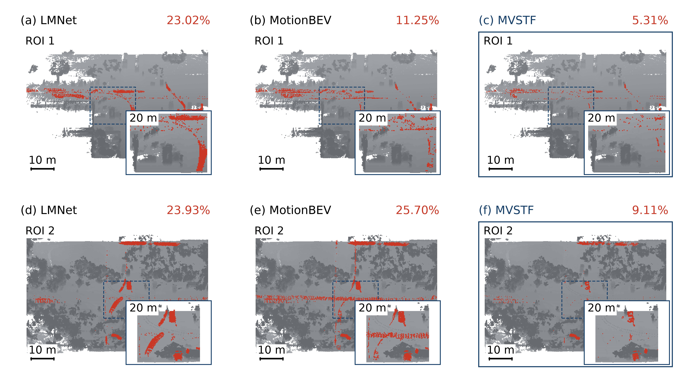

# SuMa++ + MVSTF application results

These tables and the [mapping figure](../../demo/slam/mapping.png) accompany Tables VIII–IX and Fig. 11 of the [paper](https://arxiv.org/html/2611.20872v1#S4.SS6). They report the existing offline application experiment on KITTI odometry training sequences 00–10.

## Table VIII: trajectory errors

[Full-precision CSV](odometry.csv)

| Configuration | No loop: translation (%) ↓ | No loop: rotation (°/100 m) ↓ | With loop: translation (%) ↓ | With loop: rotation (°/100 m) ↓ |
| --- | --- | --- | --- | --- |
| SuMa++ | 1.3709 ± 0.0000 | 0.3411 ± 0.0000 | 1.3475 ± 0.0139 | 0.3148 ± 0.0039 |
| SuMa++ + MVSTF | 0.8848 ± 0.0000 | 0.3272 ± 0.0000 | 0.9841 ± 0.1913 | 0.3496 ± 0.0758 |

Values are the mean ± sample standard deviation of five backend runs using fixed motion masks. Each run pools all valid 100–800 m trajectory segments across sequences 00–10. These are backend repeats, not independent model trainings. The no-loop setting uses online trajectories; the loop-closure setting uses final optimized trajectories. In the CSV, `loop0` and `loop1` identify these settings, `t` and `r` denote translation and rotation, and `sd` is the sample standard deviation.

## Table IX: dynamic filtering and static-structure preservation

[Full-precision CSV and counts](mapping.csv)

| Method | Dynamic-point removal (%) ↑ | Static-point retention (%) ↑ | Dynamic-voxel residual (%) ↓ | Static-voxel retention (%) ↑ |
| --- | --- | --- | --- | --- |
| LMNet | 92.45 | 99.9788 | 9.51 | 99.9674 |
| MotionBEV | 85.04 | 99.9914 | 12.61 | 99.9835 |
| MVSTF | 95.17 | 99.9941 | 4.02 | 99.9743 |

All methods use the same baseline-estimated poses, a 2–75 m observation range, and a 0.2 m voxel grid. Counts are pooled across sequences 00–10 before calculating ratios; sequence maps retain separate coordinate systems. These are voxel occupancy statistics before surfel fusion. Dynamic-voxel residual and static-voxel retention use dynamic-only and static-only reference voxels, respectively, excluding mixed voxels.

The CSV includes the underlying counts. Dynamic-voxel residual is the percentage remaining: `100 × (pure_dynamic − removed_pure_dynamic) / pure_dynamic`. It is the complement of dynamic-voxel removal; smaller residual values are better.

## Fig. 11: local mapping comparison

The two rows show two local regions of sequence 08; columns show LMNet, MotionBEV, and MVSTF. Red marks dynamic-only reference voxels that remain occupied; gray shows other occupied voxels. Blue dashed boxes locate the enlarged regions. The percentages refer to the entire corresponding local region. MVSTF residuals are 5.31% and 9.11%; the 4.02% value in Table IX instead pools all sequences 00–10.

The figure uses common baseline-estimated poses, voxel settings, and visualization settings. It shows voxel occupancy before surfel fusion, rather than final surfel-map accuracy. No SLAM video is bundled with these results. The existing sequence-08 MOS video in `demo/seq08.mp4` shows segmentation visualization.
